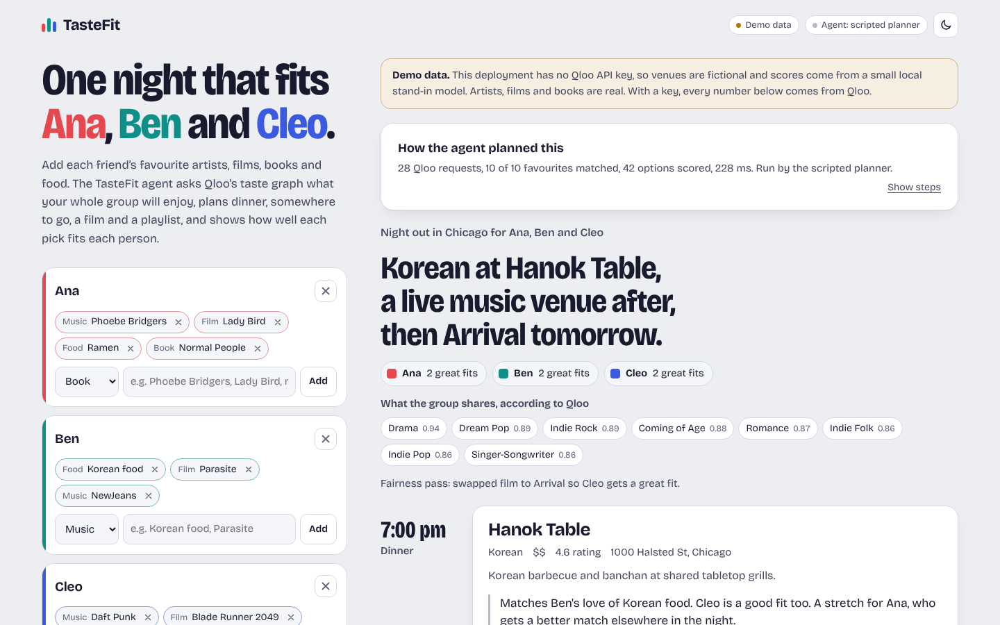
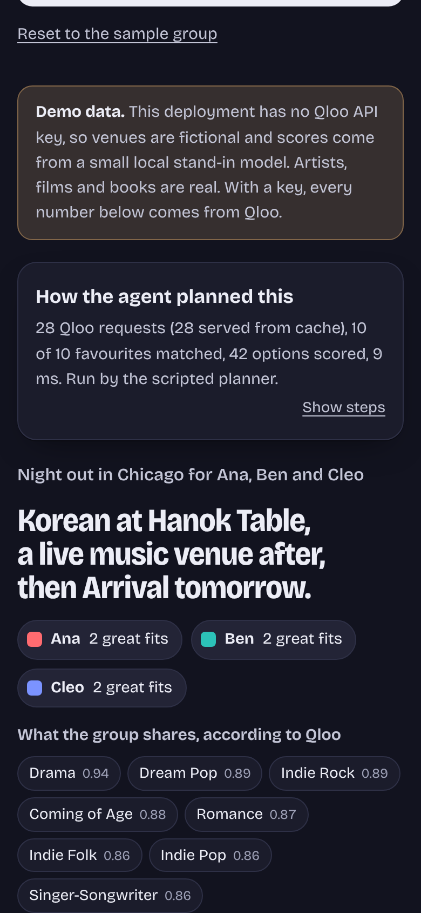
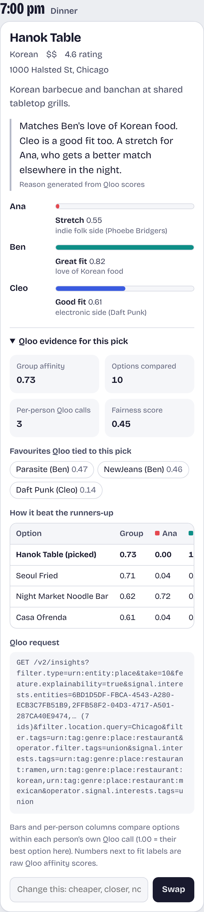
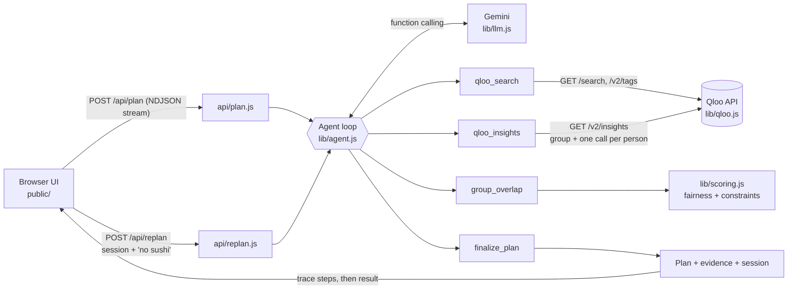

# TasteFit

**One night out that fits the whole group.** TasteFit is an AI concierge agent for friends whose tastes don't line up. Everyone adds a few favourite artists, films, books or dishes. The agent asks [Qloo's Taste AI](https://www.qloo.com/) what the group shares, plans dinner, somewhere to go, a film and a playlist, and shows how well each pick fits *each person*, with the Qloo evidence behind it. Don't like something? Say "cheaper", "closer" or "no sushi" and the agent swaps just that part.

Built for the [Qloo Agentic Hackathon](https://qloo.devpost.com/).

**Live demo: [tastefit.vercel.app](https://tastefit.vercel.app)**



<p>
  
  
</p>

## What it does

1. **Resolves every favourite to Qloo.** Artists, films, shows, books and places become Qloo entities (`/search`). Dishes and cuisines ("ramen", "Korean food") become Qloo cuisine tags (`/v2/tags`).
2. **Asks Qloo what the group shares.** For each part of the night it makes one Insights call (`/v2/insights`) with *everyone's* favourites as signals, filtered to the city. It also asks for the taste tags the group has in common.
3. **Scores every option for every person.** For each candidate set it makes one more Insights call *per person*, ranking the same candidates (`filter.results.entities`) against only that person's favourites. Now we know who each option is for.
4. **Balances the night.** Local scoring (`group_overlap`) combines group fit, average fit and the worst-off person. It then runs a fairness pass so nobody leaves without a great match.
5. **Explains itself.** Each pick says who it fits and why ("Matches Ana's indie folk side (Phoebe Bridgers) and Ben's love of Korean food"). Per-person meters show the Qloo affinity, and an evidence panel shows the runners-up and the exact Qloo request.
6. **Re-plans one slot at a time.** "Cheaper", "closer", "no sushi", "a lighter film" or "more chill playlist" change only that slot. Hard constraints persist, and a preference like "lighter" becomes a Qloo tag signal on a fresh Insights call.

## Why Qloo + an agent beats an LLM on its own

| | LLM only | TasteFit |
| --- | --- | --- |
| Venues | Plausible names, often closed, generic or invented | Real places Qloo returns for the city you typed |
| "Who will like it?" | A guess dressed up as a fact | A measured Qloo affinity per person, from a separate call per person |
| Cross-domain taste | Stereotypes ("likes K-pop, so Korean BBQ") | Qloo's taste graph links music, film, books and places from real audience data |
| Fairness | Whoever wrote the most favourites dominates | Per-person normalisation, worst-off term and a rebalance pass |
| Changes | Regenerates everything, forgets constraints | Swaps one slot, keeps "no sushi" for the rest of the session |
| Trust | Nothing to check | Every pick shows its Qloo affinity, the signals behind it, the runners-up and the request |

The LLM's job is the part LLMs are good at: deciding which tools to call, reading a messy request, and writing a friendly sentence. Every pick it commits is checked against the candidates Qloo returned. A reason that names nobody, or describes a different entity, is replaced with one generated from the Qloo scores.

## Architecture



- **Agent loop** (`lib/agent.js`). With `GEMINI_API_KEY` set, Gemini drives the four tools through function calling. The loop is capped at 8 turns and a 24-second budget, which leaves time to finish. Without a key, a scripted planner runs the same tools in a fixed order. If Gemini errors, times out or stops early, the scripted policy finishes the missing steps. `planNight()` always returns a valid plan.
- **Stateless API.** `/api/plan` returns a compact `session` (resolved favourites, scored candidates, constraints) that the browser sends back to `/api/replan`. The server stores nothing.
- **Streaming.** Responses stream as NDJSON when the client asks for `application/x-ndjson`, so the UI shows each tool call as it happens. Without that header the API returns plain JSON.

### Qloo calls

| Endpoint | Parameters used | Purpose |
| --- | --- | --- |
| `GET /search` | `query`, `types`, `take` | Resolve a favourite to a Qloo entity |
| `GET /v2/tags` | `filter.query`, `feature.semantic_search`, `take` | Resolve dishes/cuisines and preferences ("comedy") to tag URNs |
| `GET /v2/insights` | `filter.type`, `signal.interests.entities`, `signal.interests.tags`, `operator.signal.interests.tags`, `filter.location.query`, `filter.tags`, `operator.filter.tags`, `filter.exclude.tags`, `take`, `feature.explainability` | Group recommendations per slot (`urn:entity:place`, `urn:entity:movie`, `urn:entity:artist`) |
| `GET /v2/insights` | `filter.type`, `filter.results.entities`, `signal.interests.entities`, `take` | Rank the same candidates for one person |
| `GET /v2/insights` | `filter.type=urn:tag`, `signal.interests.entities` | Taste tags the group shares |

Auth is the `X-Api-Key` header against `https://api.qloo.com` by default. These names match Qloo's official hackathon harness (`@qloo/qloo-harness`), which is pinned to Qloo's OpenAPI 2.0 spec. Two details are best-effort, and the code degrades gracefully if they differ:

- The restaurant category tag (`urn:tag:genre:place:restaurant`). If the filtered call fails or returns nothing, it's retried without the tag. You can override it with `QLOO_RESTAURANT_TAG`.
- The per-signal shape of `query.explainability`. It's parsed tolerantly, and the UI falls back to each person's closest favourite.

Requests run with at most 6 in flight, a 7-second timeout, one bounded retry on 429/5xx, and a 10-minute in-memory cache.

## Modes

| `QLOO_API_KEY` | `GEMINI_API_KEY` | What runs |
| --- | --- | --- |
| set | set | Live Qloo data, Gemini agent |
| set | missing | Live Qloo data, scripted planner (same tools, fixed order) |
| missing | set or missing | **Demo data**: a mock Qloo backend under the real client (same URLs, same response shapes) |

Demo data is labelled in the header and above the plan. Artists, films, shows and books in the fixtures are real works. Places are fictional, and demo affinities come from a small hand-written stand-in model (`data/fixtures/mock-model.json`), not from Qloo. Regenerate the fixtures with `npm run fixtures`.

## Run locally

Requires Node.js 20 or newer. There are no runtime dependencies, so `npm install` isn't needed.

```sh
git clone https://github.com/arlanimanbayev/tastefit.git tastefit && cd tastefit
npm test                 # 54 unit tests (node:test), no network
npm run dev              # http://localhost:3000 in demo mode
```

To use live data, copy `env.example` to `.env` and fill in your keys. `dev-server.js` loads `.env`, and the file is git-ignored.

```sh
cp env.example .env
# QLOO_API_KEY=...   GEMINI_API_KEY=...
npm run dev
```

End-to-end check and screenshots (needs Playwright with Chromium installed globally):

```sh
npm run screenshots      # drives the UI in demo mode and writes docs/screenshots/*.png
```

## Deploy to Vercel

1. Push this folder to a public GitHub repository. The MIT `LICENSE` file makes the license show in the repo's About section.
2. In Vercel, choose **Add New → Project**, import the repository, and keep the **Other** framework preset. No build command is needed: `public/` is served as static files and `api/*.js` become Node.js functions. `vercel.json` sets `maxDuration: 30` and bundles `data/fixtures/`.
3. In **Settings → Environment Variables**, add `QLOO_API_KEY` and `GEMINI_API_KEY`. `GEMINI_MODEL` and `QLOO_BASE_URL` are optional. Then redeploy.
4. Open the deployment. The header should read **Live Qloo data** and **Agent: gemini-…**.

## Environment variables

| Name | Default | Notes |
| --- | --- | --- |
| `QLOO_API_KEY` | none | Qloo hackathon key. Without it the app runs on demo data. |
| `QLOO_BASE_URL` | `https://api.qloo.com` | Set this if Qloo issued a different host for your key. |
| `GEMINI_API_KEY` | none | Google AI Studio key. Without it the scripted planner runs. |
| `GEMINI_MODEL` | `gemini-3.5-flash-lite` | Fastest current Flash-Lite. `gemini-3.8-flash` writes richer reasons but is slower. |
| `QLOO_RESTAURANT_TAG` | `urn:tag:genre:place:restaurant` | Category tag for the dinner slot. |
| `RATE_LIMIT_PLAN` / `RATE_LIMIT_REPLAN` | `30` / `90` | Requests per IP per 10 minutes, per warm instance. `RATE_LIMIT=off` disables it. |
| `MOCK_LATENCY_MS` | `70` | Simulated latency per demo-mode request. |

## Project layout

```text
api/                 Vercel functions: plan.js, replan.js, health.js
lib/agent.js         tools, Gemini loop, scripted policy, re-plan, session round-trip
lib/qloo.js          Qloo client: URL building, auth, retries, cache, response parsing
lib/mock-qloo.js     demo-mode backend answering the same URLs with Qloo-shaped JSON
lib/scoring.js       per-person normalisation, fairness, constraints, reasons
lib/llm.js           Gemini generateContent client with function calling
lib/http.js          shared request handling, NDJSON streaming, rate limiting
public/              single-page UI (no build step), self-hosted Bricolage Grotesque font
data/fixtures/       demo catalogue, tags, mock taste model, sample responses
test/                node:test suites
scripts/             fixture builder, Playwright screenshot/e2e script
dev-server.js        zero-dependency local server
```

## Privacy and safety

- People's names never go to Qloo. Qloo only receives favourites text, tag/entity IDs and the city.
- With Gemini enabled, the brief (first names, favourites, city) is sent to Google to plan and write reasons.
- Nothing is stored server-side. The plan session lives in the browser tab, and the composer is remembered in `localStorage` on your own device.
- API keys stay on the server. The browser only talks to `/api/*`. A strict Content-Security-Policy blocks inline scripts and third-party code.
- Qloo affinities describe aggregate taste patterns, not facts about an individual. TasteFit presents them as "fit", not as predictions about a person.

## Limitations

- Re-planning can only pick from what Qloo returns for that slot. If nothing meets a request, the agent says so and keeps the current pick.
- "Closer" uses the venue coordinates Qloo returns. If a place has none, distance is ignored.
- The plan is a suggestion: it doesn't check opening hours or make bookings.

## License

[MIT](LICENSE) © 2026 Arlan Imanbayev. The Bricolage Grotesque font is licensed under the SIL Open Font License (`public/fonts/OFL-LICENSE.txt`).
